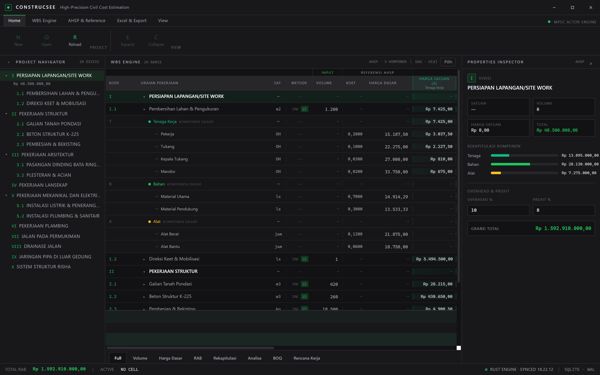
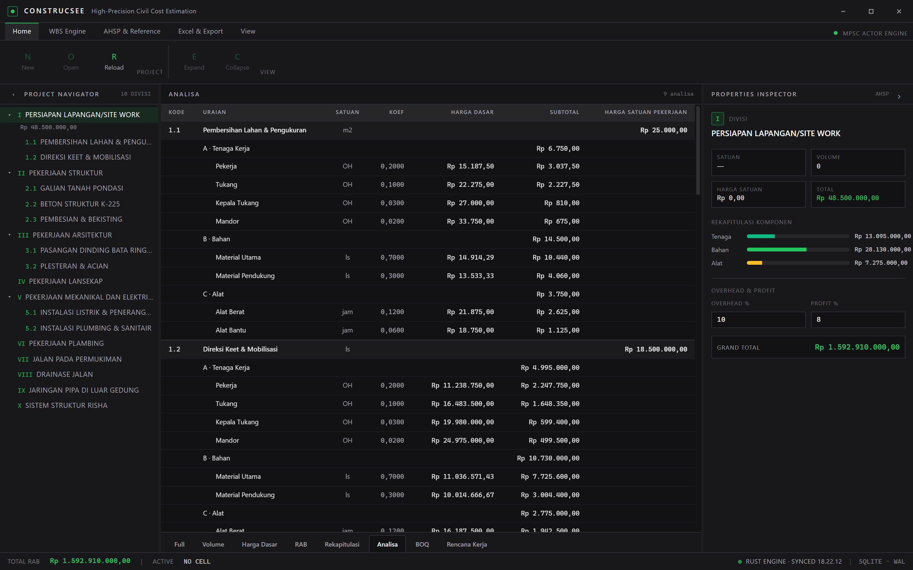
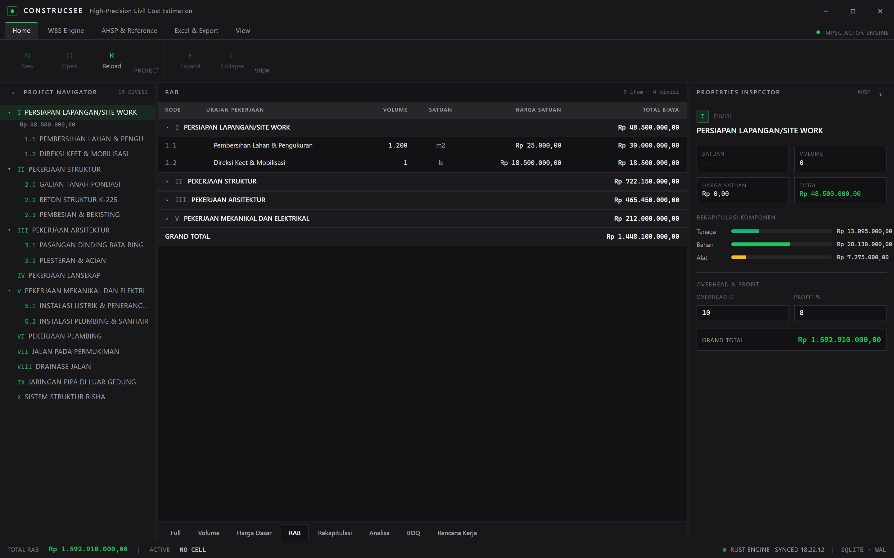
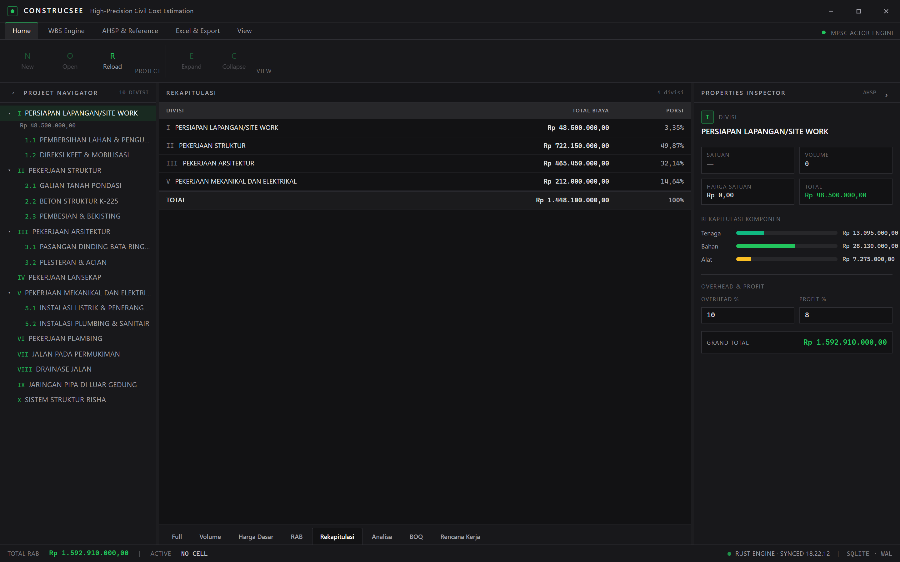

# ConstrucSee (v2)

High-precision civil cost estimation & WBS engine — desktop app built with **Tauri v2 + Rust + React 18 + TypeScript + Vite 6 + Tailwind 3 + Zustand 5**.

ConstrucSee memodelkan pekerjaan konstruksi sebagai WBS (Work Breakdown Structure) berbasis SNI/AHSP: setiap item pekerjaan diturunkan menjadi komponen **Tenaga Kerja (A) / Bahan (B) / Alat (C)**, lengkap dengan analisa harga satuan, kuantitas/BOQ, dan rekapitulasi biaya.

## Tangkapan Layar

**Sheet Full / WBS** — struktur divisi → item, baris komponen dasar (A/B/C) dan item resource:



**Sheet Analisa** — analisa harga satuan per pekerjaan:



**Sheet RAB** — rekap per divisi yang dapat dilipat:



**Sheet Rekapitulasi** — biaya dan porsi per divisi:



Selengkapnya di [`docs/screenshots/`](docs/screenshots).

## Fitur

- **WBS Engine** — struktur divisi → subdivisi → item pekerjaan (leaf) dengan rollup biaya otomatis lewat actor engine Rust (mpsc).
- **Analisa AHSP** — baris komponen dasar dan item resource (nama + satuan + koefisien) diperluas per leaf.
- **Katalog AHSP ter-bundle** — dialog tambah pekerjaan dengan pencarian, filter per divisi/subdivisi, dan input bulk via keranjang.
- **Dua metode harga** — `ahsp` (harga satuan = jumlah komponen, read-only) dan `langsung` (harga satuan dapat diinput).
- **Input dua arah** — sheet Volume, Harga Dasar (item jadi sumber kebenaran), dan Rencana Kerja (pekerja ↔ durasi).
- **Sheet navigasi** — Full, Volume, Harga Dasar, RAB, Rekapitulasi, Analisa, BOQ, Rencana Kerja.
- **Bulk delete** — mode pilih pada WBS, hapus leaf sekaligus dengan konfirmasi.
- **Overhead & PPN** — overhead dibakar ke kolom komponen; footer rekap Grand Total + PPN.
- **Persistensi SQLite** (rusqlite) dengan migrasi otomatis dan backfill komponen untuk database lama.

## Unduh & Instalasi

Release **v1.0.1** sudah tayang di tab **[Releases](../../releases)**, tetapi asset installer belum dilampirkan. Build lokal Windows 64-bit menghasilkan `ConstrucSee_1.0.1_x64-setup.exe` (NSIS) dan `ConstrucSee_1.0.1_x64_en-US.msi` (MSI) melalui `npm run tauri -- build`.

Kebutuhan: **Windows 10/11 64-bit**. WebView2 Runtime dibutuhkan (diunduh otomatis bila belum ada). Installer lokal belum ditandatangani secara digital, jadi SmartScreen dapat menampilkan "Windows protected your PC" → **More info → Run anyway**.

## Pengembangan

```bash
npm install
npm run dev          # Vite dev server (mock engine di browser)
npm run tauri dev    # aplikasi desktop (engine Rust)
npm run typecheck    # tsc --noEmit
npm run build        # build frontend
npm run tauri build  # build installer desktop
```

> Saat dijalankan lewat browser (`npm run dev`), aplikasi memakai **mock engine** di memori, bukan engine Rust.

## Struktur

| Path | Isi |
|------|-----|
| `src/` | Frontend React (komponen `shell`, `wbs`, `sheets`, `inspector`, `navigator`, `ahsp`; lib `tree`, `sheets`, `ahsp`, `order`, `format`, `mockEngine`) |
| `src-tauri/` | Engine Rust (actor mpsc, models, calc, db SQLite, seed, importer/exporter Excel) |
| `public/data/ahsp.json` | Katalog AHSP ter-bundle (sumber SE DJBK + AHSP user defined) |
| `docs/` | Dokumentasi arsitektur & konteks pengembangan |

## Lisensi

Belum ditentukan (UNLICENSED).
